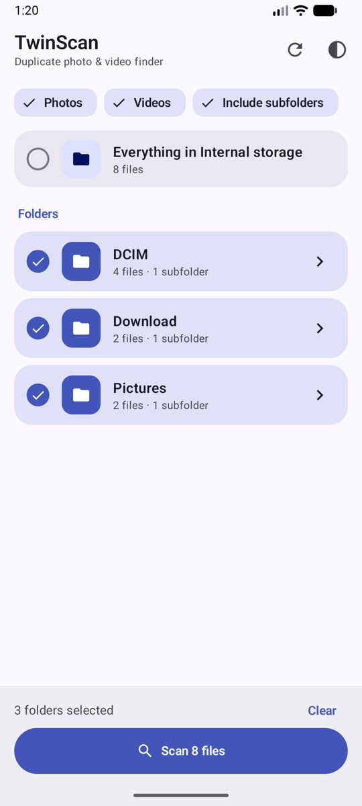
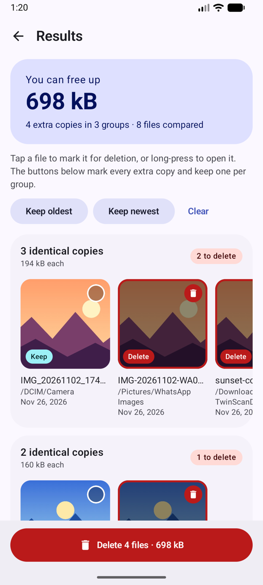
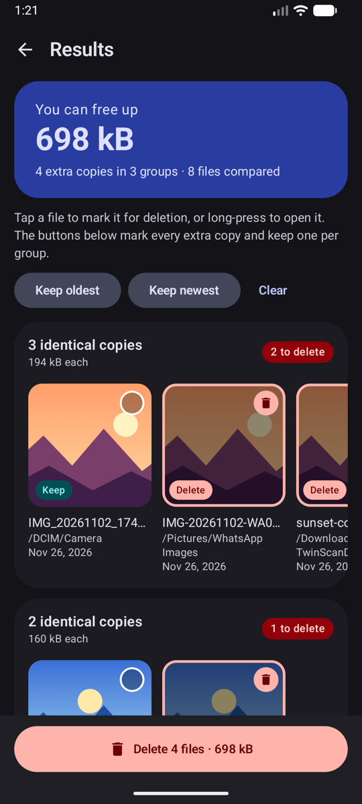

<p align="center">
  
</p>

<h1 align="center">TwinScan</h1>

<p align="center">
  Find duplicate photos and videos on your Android phone and free up space.<br>
  You choose the folders. Nothing leaves your device.
</p>

<p align="center">
  
  &nbsp;
  
  &nbsp;
  
</p>

## What it does

- **Scans only where you tell it to.** Pick one folder, several folders, or drill down to specific subfolders.
- **Finds true duplicates.** Files are matched by their contents, so copies are found even when they have different names or sit in different folders.
- **Shows you everything before deleting.** Duplicates are grouped side by side with their folder and date, so you can see which copy is which.
- **One-tap clean-up.** Keep the oldest or the newest copy in every group, or mark files one by one.
- **Private by design.** The app has no internet permission. Your photos and videos are compared on the phone and never uploaded.
- **Light and dark themes**, following your system setting or your own choice.

## How to use it

1. **Allow access** to photos and videos when the app asks.
2. **Choose folders.** Tap a folder to select it. Tap the arrow on the right to open it and pick subfolders instead.
3. **Adjust what is scanned** with the chips at the top: Photos, Videos, and Include subfolders.
4. **Tap Scan.** A progress ring shows how far along it is. You can cancel at any time.
5. **Review the results.** Tap a file to mark it for deletion, or long-press to open it. Use **Keep oldest** or **Keep newest** to mark all the extra copies at once.
6. **Tap Delete** and confirm. Deleted files cannot be recovered.

> **Tip:** if a folder is missing from the list, tap the refresh icon. Only folders that contain photos or videos are shown.

## Good to know

- **Exact copies only.** A photo that was resized, edited, or re-compressed (for example, sent through a chat app) is a different file and will not be matched.
- **Deleting is permanent.** Files are removed, not moved to a bin. The app warns you if you are about to delete every copy in a group.
- **Hidden folders are skipped.** Folders that Android does not index, such as those containing a `.nomedia` file, do not appear.
- **Limited access on Android 14+.** If you grant access to selected photos only, TwinScan can scan just those.

## Requirements

- Android 7.0 (API 24) or newer

## Install

TwinScan is not on Google Play yet. To try it, build it from source:

```bash
git clone https://github.com/SahasPunchihewa/twin-scan.git
cd twin-scan
./gradlew app:installDebug
```

This needs the Android SDK and a phone with USB debugging enabled (or a running emulator). You can also open the project in Android Studio and press **Run**.

## How it works

Comparing every file byte by byte would be slow, so TwinScan narrows things down in three steps:

1. **Size** — files with a unique size cannot have a duplicate and are skipped.
2. **Quick check** — the first 64 KB of each remaining file is hashed.
3. **Full check** — files that still match are hashed completely (SHA-256) to confirm they are identical.

The list of folders and files comes from Android's media index (`MediaStore`), which is why the app does not need the broad "all files access" permission.

## Built with

- Kotlin and Jetpack Compose (Material 3)
- A single-activity app with a `ViewModel` and `StateFlow`
- No third-party libraries

```
app/src/main/java/com/sahas/twinscan/
├── data/            Media index, folder tree, duplicate finder
├── ui/              Screens, shared components, previews
├── ui/theme/        Colours, typography, light/dark themes
├── ScanViewModel.kt App state, scan and delete flow
└── MainActivity.kt
```

## License

Released under the [MIT License](LICENSE).
